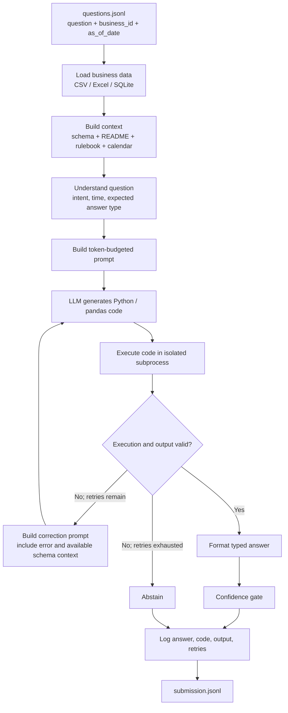

# DataMate — AI Agent for Vietnamese Tabular QA

> **Zalo AI Challenge 2026 — DataMate Track**  
> An autonomous agent answering natural-language Vietnamese business questions directly over structured heterogeneous tabular data (CSV, Excel, SQLite).

---

## 🚀 Key Highlights & Architecture

- **Universal Multi-Format Ingestion**: Auto-detects and loads CSV, multi-sheet XLSX, and SQLite databases with Vietnamese character encoding detection (`charset-normalizer`) and NFC Unicode normalization.
- **Vietnamese Business Context & Time Resolver**: Resolves relative temporal queries ("tháng này", "tuần rồi", "cùng kỳ năm ngoái", "quý này") and lunar calendar events (Tết, tháng Chạp, mùng 10) against `as_of_date` and `calendar.csv`.
- **Rulebook Interpreter**: Automatically extracts and enforces competition business logic (revenue formulas, cost calculations, "bán chạy" = quantity ranking, VAT & delivery fee exclusion, cancelled order handling).
- **Sandboxed Code Execution & Self-Correction**: Translates questions into executable pandas/Python code executed in a restricted subprocess with automated retry and syntax/runtime error feedback.
- **Strict Format Compliance**: Guarantees typed and normalized answers (`number`, `percent`, `string`, `date`, `boolean`, `list`, `table`, `unanswerable`, `abstain`) matching the competition evaluation metric.
- **Risk-Calibrated Abstention**: Optimized for Penalized Accuracy (PA = `(correct - wrong) / total`), abstaining (score = 0) rather than guessing when data is missing or confidence is low.
- **Offline & Multi-GPU Ready**: Fully self-contained Docker container optimized for 2× NVIDIA RTX 5090 (Blackwell architecture, CUDA 12.8+, vLLM / HuggingFace Transformers).

---

## 📁 Repository Structure

```
d:\datamate\
├── data/
│   ├── train/                  # Training businesses data + answers.jsonl
│   └── public_test/            # Public test data
├── docker/
│   ├── Dockerfile              # Offline CUDA 12.8+ submission image
│   └── predict.sh              # Container entrypoint script
├── prompts/
│   └── templates/
│       ├── system_prompt.txt   # Base system instruction for code generation
│       └── few_shot_examples.json # Curated few-shot demonstrations by question type
├── src/
│   ├── modules/
│   │   ├── answer_formatter.py       # Type-safe normalization & formatting
│   │   ├── code_executor.py          # Sandboxed Python code executor
│   │   ├── confidence_gate.py        # Uncertainty & abstention decision gate
│   │   ├── data_loader.py            # CSV / XLSX / SQLite reader & cache
│   │   ├── prompt_builder.py         # Dynamic prompt constructor
│   │   ├── question_logger.py        # Per-question JSON execution trace logger
│   │   ├── question_understanding.py # Intent & entity classification
│   │   ├── readme_parser.py          # Business README.md extractor
│   │   ├── retry_engine.py           # LLM generation & execution retry loop
│   │   ├── rulebook_interpreter.py   # Rulebook parser & rule matcher
│   │   ├── schema_registry.py        # Unified table schema & metadata store
│   │   └── time_resolver.py          # Vietnamese temporal & lunar resolver
│   ├── predict.py              # Main orchestrator CLI
│   └── evaluate.py             # Local Penalized Accuracy (PA) scorer
├── tests/                      # Full pytest unit & integration test suite (55 tests)
├── pytest.ini
├── requirements.txt
└── README.md
```

---

## 🛠️ Setup & Installation

### Local Environment
Requires Python 3.10+ (tested on Python 3.11 & 3.14):

```bash
pip install -r requirements.txt
```

### Running Tests
Execute the entire test suite (all 55 unit and integration tests):

```bash
pytest tests/ -v
```

### Git Commit Hooks
Install the development dependencies to enable the Husky `commit-msg` hook.
Commit messages are checked against the [repository commit convention](CONVENTION.md):

```bash
npm install
```

Examples:

```text
feat: add question retry handling
fix(data-loader): parse Excel serial dates
docs: update pipeline overview
```

---

## ⚡ Inference & Submission Pipeline

### Pipeline Overview



The retry loop is DataMate's self-correction step: execution errors, answer
type mismatches, and missing results can be sent back to the LLM with feedback
for another code-generation attempt, up to `max_retries`. A successful code
execution is not by itself proof that the business answer is correct; the
confidence gate applies heuristics and can abstain when confidence is low.
Prompt construction also enforces the model's input-token budget and abstains
if required context cannot fit.

When a numeric zero comes from an empty derived DataFrame, the retry prompt
includes the real category values so the model can correct a mismatched filter.

### Structured analysis-plan pilot

The pipeline has an opt-in `--analysis-plan` mode. It asks the model for a
strict JSON plan (table, aggregation, filters, date interval, grouping, and
output shape), validates names/values against the loaded DataFrames, and
executes supported `sum`, `count`, `nunique`, `mean`, `min`, and `max`
operations without evaluating generated Python. Invalid or unsupported plans
fall back to the existing pandas-code/retry path. This pilot currently supports
numeric, string, list, and table plans; percent, date, boolean, and
unanswerable questions skip planning and use the existing path directly. An
unsupported plan may require a second model call, so measure latency and plan
coverage before enabling it broadly. It is disabled by default.

### 1. Local Prediction CLI
```bash
python src/predict.py \
    --data-dir data/train \
    --output-dir result/ \
    --model-dir /path/to/qwen2.5-coder-14b \
    --max-retries 3 \
    --confidence-threshold 0.35 \
    --analysis-plan
```

### 2. Local Penalized Accuracy (PA) Evaluation
Evaluate predictions on the training split:
```bash
python src/evaluate.py \
    --submission result/submission.jsonl \
    --answers data/train/answers.jsonl \
    --output result/eval_summary.json
```

### Prompt Context Budget

The prompt builder measures prompts with the active model tokenizer and removes
optional sample rows, examples, and business context before compacting the
schema. It preserves table variables, column names, business rules when they
fit, and the question. If the required prompt still exceeds the input budget,
the pipeline records an abstention instead of repeatedly sending an oversized
prompt.

The vLLM generator defaults to an 8,192-token context, reserves 1,024 tokens
for generation and 512 safety tokens, and uses the remainder as the prompt
budget. Set these environment variables only to values supported by the model
and runtime:

```bash
VLLM_MAX_MODEL_LEN=8192
VLLM_MAX_NEW_TOKENS=1024
DATAMATE_PROMPT_SAFETY_TOKENS=512
```

Date-like columns containing Excel serial days or Vietnamese month text are
normalized by the data loader. Generated code should compare pandas datetime
columns with `pd.Timestamp` values rather than converting whole columns to
Python `date` objects.

---

## 🐳 Docker Deployment

Build the offline container image:
```bash
docker build -t datamate-agent:latest -f docker/Dockerfile .
```

Run inference using the official competition volume mounts:
```bash
docker run --gpus all --rm \
    -v /path/to/host/data:/data:ro \
    -v /path/to/host/result:/result:rw \
    -v /path/to/host/models:/app/models:ro \
    datamate-agent:latest
```

Entrypoint `/app/predict.sh` automatically reads questions from `/data/questions.jsonl`, queries data in `/data/data/<biz_id>/`, and writes the formatted predictions to `/result/submission.jsonl` and detailed execution traces to `/result/logs/`.
