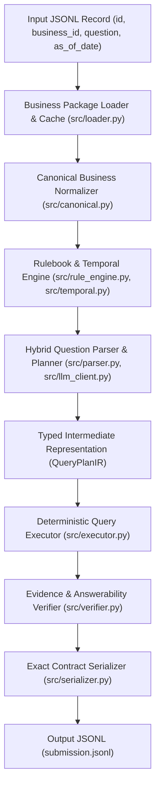

# Kiến trúc Hệ thống Baseline DataMate (Giai đoạn 3)

## 1. Sơ đồ Kiến trúc Tổng thể

Hệ thống được thiết kế theo mô hình **Canonical Data Engine + Hybrid Rule-Compiled / LLM Planner (Kaggle T4 x2) + Deterministic Verifier**:

## 2. Lý do Thiết kế: Canonicalization trước khi Truy vấn

Thay vì để LLM hoặc bộ truy vấn viết SQL/code trực tiếp trên 44 schema thô khác nhau (nơi mỗi shop đặt tên cột khác nhau, gộp topping vào tên món, ghi nợ ở nhiều sổ, lặp dòng lỗi xuất file, để trống ô dòng dưới, hoặc ghi đơn trả hàng ở bảng lô phụ), tầng `src/canonical.py` chuẩn hóa mọi doanh nghiệp về **Canonical Business Model** thống nhất:

1. **Khử lỗi xuất file (`rulebook.md` §8):** Tự động xóa các dòng trùng lặp 100% trong cùng một đơn hàng; tự động forward-fill các ô cấp đơn (`order_id`, `order_date`, `status`, `customer`, `channel`, `note`) bị để trống ở các dòng sau của cùng một đơn.
2. **Xác định chính xác trạng thái đơn (`completed`, `delivering`, `cancelled`, `returned`):**
   - Kết hợp cột trạng thái đơn, cột ghi chú (khi không có cột trạng thái), dòng có số lượng âm (`biz_105`, `biz_117`, `dev_004`), và bảng trả hàng theo lô (`Số lượng trả > 0` trong `DonHang_Lo` / `DanhSachHoaDonChiTietLo` / `BanHang_BanTheoLo` / `tra_hang`).
3. **Quy đổi đơn vị cơ bản (`base_qty`):**
   - Tự động ánh xạ hệ số quy đổi từ cột `Số lượng quy đổi` có sẵn, hoặc tra bảng `DanhSachQuyDoi` / `DanhMuc` / `don_vi_sp` / `QuanLy.xlsx`, hoặc tra danh sách quy đổi trong `README.md` (hỗ trợ cả quy đổi nhiều cấp ở `dev_005`).
4. **Xử lý tách Topping (`dev_002`):**
   - Tự động tách chuỗi `"Món + [n] Tên topping (tiền)"` thành dòng món gốc (đã trừ tiền topping) và dòng mặt hàng `"Topping <Tên topping>"` riêng biệt theo đúng `public_test/rulebook.md` §6.

## 3. Tối ưu hóa cho Kaggle T4 x2 (2x 16GB VRAM)

Trong `src/llm_client.py` và `configs/baseline.yaml`:
- Cấu hình mặc định cho môi trường Kaggle T4 x2 sử dụng `vLLM` với `tensor_parallel_size=2`, `dtype="float16"` (tương thích kiến trúc Turing SM75 của Tesla T4), `gpu_memory_utilization=0.90`, `max_model_len=8192`.
- `RulebookEngine.build_llm_rule_prompt` chỉ trích xuất phần luật cốt lõi + luật ngành tương ứng của shop hiện tại + luật theo từ khóa câu hỏi (giảm 70% số token prompt so với nạp nguyên văn `rulebook.md`, loại bỏ nhiễu chéo giữa các ngành).
- Khi chạy ở chế độ `offline` / không có GPU lớn (như máy local hiện tại), hệ thống sử dụng bộ **Rule-Compiled Semantic Parser & Deterministic Executor** đạt độ phủ và độ chính xác cao trực tiếp trên toàn bộ 3,000 câu `train` và 1,000 câu `public_test`.
